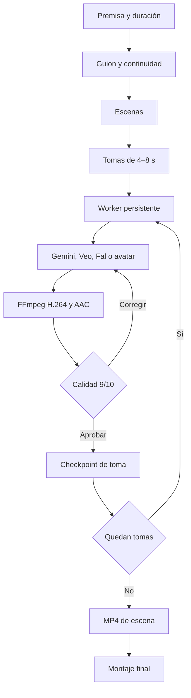

# Arquitectura de producción 3.0

## Responsabilidades

- Next.js sirve el panel y endpoints breves.
- `scripts/worker.ts` ejecuta trabajos largos fuera del ciclo HTTP.
- `project.json` es el estado durable de cada producción.
- `shot-plan.ts` convierte escenas narrativas en tomas filmables.
- Los adaptadores de OpenAI, Gemini/Veo y Fal.ai crean recursos individuales.
- `quality-review.ts` evalúa cada MP4 y liga la aprobación a huellas SHA-256.
- `scene-checkpoints.ts` publica archivos validados y checkpoints atómicos.
- FFmpeg normaliza, concatena, mezcla y exporta.

## Salida común

- MP4 H.264, YUV 4:2:0 y 25 fps.
- AAC, 48 kHz, estéreo.
- 1280×720 en 16:9 o 720×1280 en 9:16.
- SRT separado y subtítulos integrados opcionales.

## Regla de producción real

En `PRODUCTION_MODE=real`, un fallo de proveedores detiene la toma con un error explícito. No convierte la toma en una fotografía con zoom. El modo demo sí usa placas animadas para validar localmente el montaje sin costo.

## Escalamiento

Para varios equipos simultáneos, sustituye archivos JSON por PostgreSQL, el worker local por Temporal o una cola durable y los recursos por almacenamiento de objetos. Los límites de concurrencia y gasto deben mantenerse por proyecto y proveedor.
