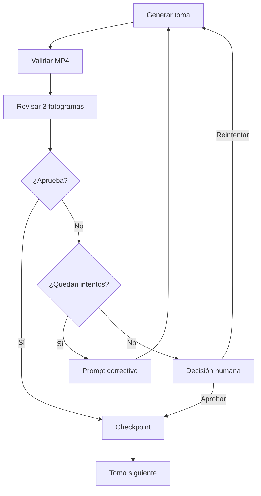

# Puerta estricta de calidad por toma

ViralCine 3.0 perfecciona cada toma antes de iniciar la siguiente. El flujo es automático y solo pide aprobación humana cuando una toma agota sus intentos.



## Criterios

El supervisor califica de 0 a 10:

- correspondencia narrativa;
- continuidad e identidad;
- calidad visual;
- composición e iluminación;
- consistencia de movimiento;
- preparación profesional.

La política recomendada exige promedio de 9.0, todas las categorías en 8.0 o más y ningún fallo crítico. Identidad incorrecta, anatomía gravemente rota, texto no solicitado, corrupción o contradicción del guion son fallos críticos.

## Corrección y decisión humana

Cada fallo produce un prompt correctivo que se incorpora al siguiente intento. Tras el máximo configurado, el panel muestra la toma, nota y defectos. `Reintentar escena` regenera únicamente esa toma; `Aprobar y continuar` conserva el resultado mediante aprobación manual.

## Auditoría

Cada informe guarda modelo, intento, notas, fortalezas, defectos, corrección y huellas SHA-256 de imagen, voz y video. El informe identifica escena y toma. Una evaluación antigua no puede aprobar archivos diferentes.

```env
SCENE_QUALITY_MODE=strict
OPENAI_QUALITY_MODEL=gpt-5.6
SCENE_QUALITY_MIN_SCORE=9.0
SCENE_QUALITY_MAX_ATTEMPTS=3
COST_QUALITY_REVIEW=0.03
```

El modo demo omite la evaluación visual facturable. Tres intentos son un límite preventivo, no un gasto obligatorio: si la toma aprueba al primer intento, no se generan los demás. Ningún sistema garantiza perfección artística absoluta, pero esta puerta aplica una regla medible, auditable y reanudable.
